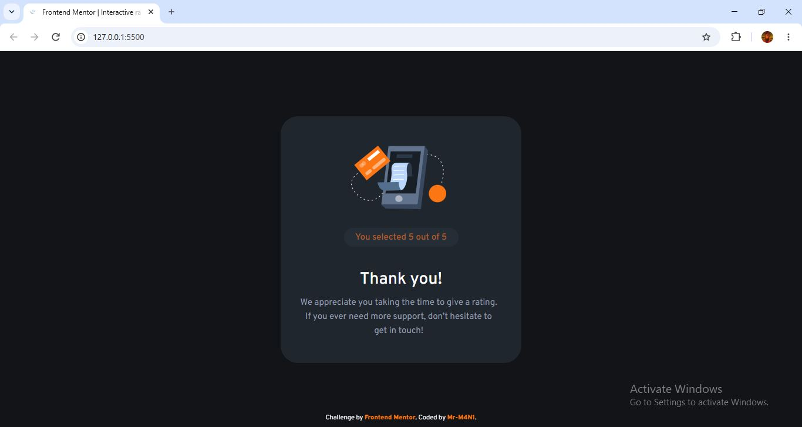
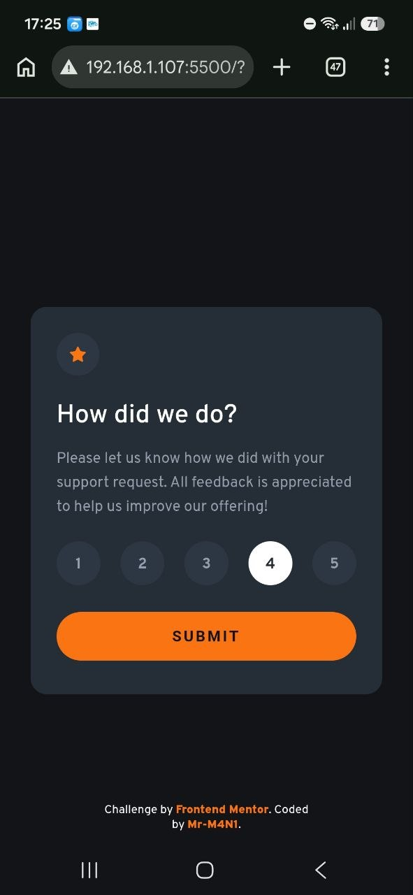
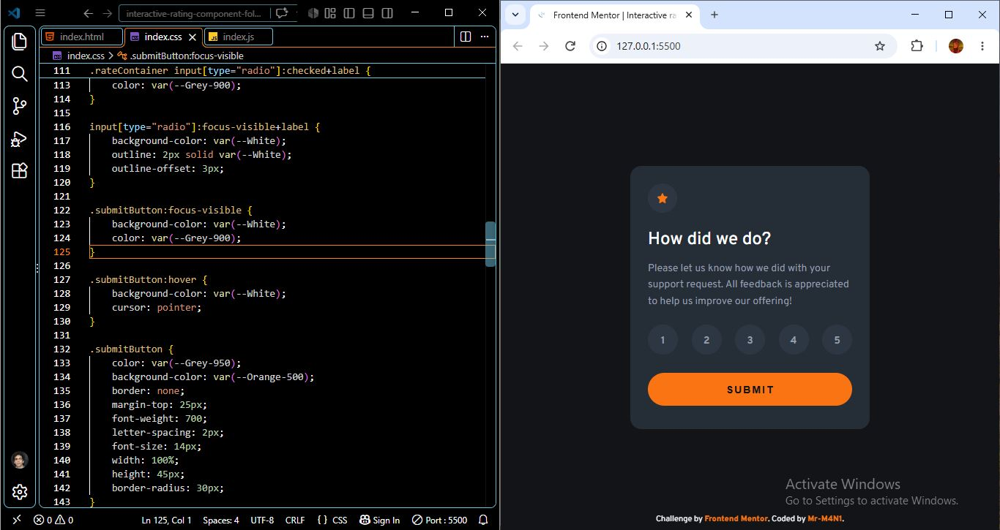

# Frontend Mentor - Interactive rating component solution

This is a solution to the [Interactive rating component challenge on Frontend Mentor](https://www.frontendmentor.io/challenges/interactive-rating-component-koxpeBUmI). Frontend Mentor challenges help you improve your coding skills by building realistic projects. 

## Table of contents

- [Overview](#overview)
  - [The challenge](#the-challenge)
  - [Screenshot](#screenshot)
  - [Links](#links)
- [My process](#my-process)
  - [Built with](#built-with)
  - [What I learned](#what-i-learned)
  - [Continued development](#continued-development)
  - [Useful resources](#useful-resources)
  - [AI Collaboration](#ai-collaboration)
- [Author](#author)
- [Acknowledgments](#acknowledgments)

## Overview

This project is an interactive rating component built with HTML, CSS, and JavaScript. Users can select a rating from 1 to 5 and submit it to see a thank-you message displaying their selected rating.

### The challenge

Users should be able to:

- View the optimal layout for the app depending on their device's screen size
- See hover states for all interactive elements on the page
- Select and submit a number rating
- See the "Thank you" card state after submitting a rating

### Screenshot

### Links

- Solution URL: [click fo Solution](https://your-solution-url.com)
- Live Site URL: [click fo Live Server](https://your-live-site-url.com)

## My process

### Built with

- Semantic HTML5 markup
- CSS custom properties
- javaScript
- Flexbox
- Mobile-first workflow

### What I learned

While working on this project, I was able to build on what I learned in my previous project and discover several new concepts.

- **DOM manipulation:** I applied what I had learned about `classList` in my previous project to switch between the rating and thank-you states.

- **querySelector():** I learned that `querySelector()` is not limited to selecting elements by class; it can also select elements using CSS selectors, including IDs, attributes, and element types.

- **HTML forms and JavaScript events:** I learned more about handling form submissions and using `event.preventDefault()` to prevent the page from reloading when the form is submitted.

- **CSS box-sizing:** I gained a better understanding of how `box-sizing` affects the way an element's width and height are calculated, especially when padding and borders are involved.

- **Accessibility:** I became more familiar with screen readers and the importance of making websites accessible to a wider range of users. I also learned how to use `aria-live="polite"` to announce dynamic content updates to screen readers without unnecessarily interrupting the user.

This project helped me realize that building a website is not just about making it look and work correctly, but also about making it accessible and usable for as many people as possible.

### Continued development

In my future projects, I want to improve my understanding of web accessibility, especially how to make interactive components more accessible to users who rely on screen readers and keyboard navigation.

I also want to strengthen my JavaScript skills, particularly DOM manipulation, event handling, and form validation, so I can write cleaner and more maintainable code.

Finally, I plan to keep improving my responsive design skills and learn more about writing semantic HTML and creating better user experiences across different devices.

### Useful resources

ColorZilla - 
- [ColorZilla](https://chromewebstore.google.com/detail/colorzilla/bhlhnicpbhignbdhedgjhgdocnmhomnp?hl=en) - A browser extension I used to pick colors from web pages and identify their color values while styling my project.

### AI Collaboration

## AI Collaboration

I used ChatGPT as an AI assistant throughout this project to help me understand concepts, debug issues, and improve my code.

Rather than simply copying solutions, I asked questions to understand how different parts of my code worked and how I could improve them while keeping my original code structure.

ChatGPT helped me better understand JavaScript concepts such as `querySelector()`, `classList`, and `event.preventDefault()`, as well as CSS properties like `box-sizing`.

I also explored accessibility improvements, including keyboard navigation and the use of `aria-live="polite"` to help screen readers announce dynamic content updates.

Overall, using AI as a learning and debugging partner helped me solve problems, understand my mistakes, and become more confident in my own coding skills.

## Author

- Frontend Mentor - [@MR-M4N1](https://www.frontendmentor.io/profile/MR-M4N1)
- Pinterest - [@MR-M4N1](https://www.pinterest.com/mrm4n1/?invite_code=4dc73b0e43814c3395c2f9600625eb5d&sender=1093671228168293050)

## Acknowledgments

- Thanks to [Frontend Mentor](https://www.frontendmentor.io/) for providing this challenge and helping me improve my frontend development skills.
- Special thanks to [OpenAI](https://openai.com/) and ChatGPT for helping me debug issues, understand new concepts, and learn throughout this project.
- Thanks to [Visual Studio Code](https://code.visualstudio.com/) for providing a useful development environment for writing and testing my code.
